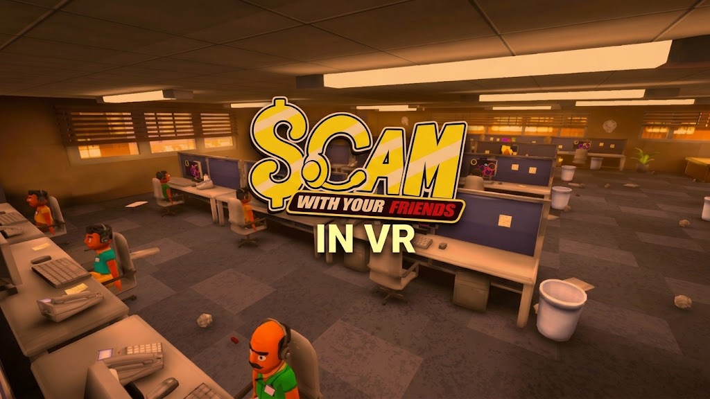

# ScamWithYourFriendsInVR

**Your headset. Your hands. Your extremely questionable day job.**

An open-source VR conversion for **Scam With Your Friends**, built with BepInEx and OpenXR.

[Quick start](docs/GETTING-STARTED.md) · [How to play](docs/HOW-TO-PLAY.md) · [Build](docs/BUILD.md) · [Troubleshooting](docs/TROUBLESHOOTING.md) · [Project status](docs/VALIDATION.md)

## What you get

- Tracked headset and controller hands, movement and snap turning.
- A controller laser for menus and computer apps, with click, drag, scroll and context-click support.
- Readable floating menus, a HUD that follows your view, and VR options inside General settings.
- Computer apps stay on their desk monitor and use the controller laser. An optional floating desktop is available.
- Native pickup, jump, weapon/punch, pee and fart input integration.
- Modded PC/VR lobbies with tracked avatar poses and a PC mode that skips XR startup.
- A Visual Studio solution, dependency preparation, reversible runtime hooks and optional in-game tests.

> **Status: development preview.** The general VR view and menus work. Computers, body movement, multiplayer and performance still need work and more headset testing. [What works and what needs work.](docs/VALIDATION.md)

## Get started

1. Use the supported **Windows x64 Mono** game build: Unity **6000.3.26f1** (current) or **6000.3.10f1** (legacy).
2. [Build and stage the runtime](docs/BUILD.md), then install into a separate game copy using the [setup guide](docs/GETTING-STARTED.md).
3. Connect your headset and choose your active PC OpenXR runtime. Quest 3 through Steam Link uses SteamVR.
4. Use `tools/Launch-Game.ps1 -GameDir 'D:\Games\SWYF-VR' -Mode VR` to verify the installation, select VR mode and launch.

This is a PC VR mod, not a standalone Quest app. The stock game strips required XR APIs, so copying only the plugin DLL will not enable VR.

## Controls at a glance

| Quest input | Action |
| --- | --- |
| Left stick | Move; scroll when pointing at UI |
| Right stick left/right | Snap turn |
| Right trigger | Click, hold/drag, or interact |
| Right grip | Pick up / hold; release to drop |
| Right grip + trigger, away from UI | Native punch / weapon input |
| Right B | Computer context click |
| Right A | Jump |
| Left X | Players |
| Left Y / controller menu | Back / settings |
| Hold left stick click | Recenter |
| Left grip + left trigger | Pee |
| Left grip + left X | Fart |

[Full controls and computer instructions →](docs/HOW-TO-PLAY.md)

## PC and VR together

Set `[General] Mode = VR` on the headset client, and `Mode = PC` on a flat-screen client. Restart after changing it. The host needs the mod to relay poses; PC players need the mod to see tracked movement. [Multiplayer setup and limitations →](docs/MULTIPLAYER.md)

## Develop

Open `ScamWithYourFriendsInVR.sln` in Visual Studio 2026, or build with the .NET 10 SDK. [Dependency preparation, staging and source exports →](docs/BUILD.md)

Contributions should preserve native gameplay authority, clean up owned state, and include evidence matching the change. [Contribution guide →](CONTRIBUTING.md)

## License and credits

Original mod source and tooling use the [MIT license](LICENSE). Game assets, Unity libraries and third-party dependencies retain their own licenses; see [third-party notices](docs/THIRD-PARTY-NOTICES.md). This is an unofficial mod, independent of the game's developers.
